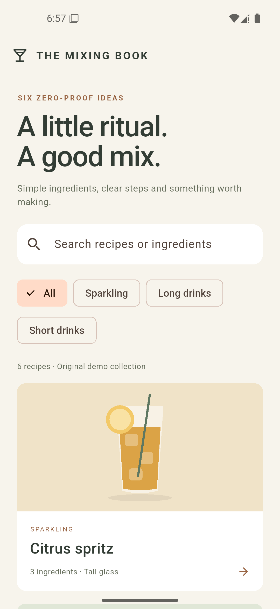

# The Mixing Book · Cocktail recipes

A Flutter recipe browser with ingredient search, category filters and complete, scrollable preparation pages. The included collection contains 6 original zero-proof drinks.



This is a refreshed portfolio edition of an earlier technical exercise. The current implementation, demo data and interface were revised in 2026. It is a local learning/demo application; deployment, accounts and production operations are outside its scope.

## Run

Tested with Flutter **3.35.6 / Dart 3.9.2**.

```sh
flutter pub get
flutter run -d chrome --web-port 4442
```

Or choose an Android device using `flutter devices`, then `flutter run -d <device-id>`. Android requires the Android SDK/JDK and accepted SDK licenses. No iOS runner is included or validated in this edition.

## Explore

Search for `orange` to find drinks by ingredients, choose **Sparkling**, then open **Citrus spritz**. Scroll through the quantities, preparation and finishing touch. Try a missing ingredient for the empty state.

The bundled recipes and preparation text were authored for this edition. They replace a dependency on an external cocktail JSON file, keeping the example reproducible and the included content’s provenance clear. The drink illustrations are original vector drawings. The collection makes no claim to be an official bartending standard.

## Data and optional feed

The default collection is `assets/recipes.json`. No account, API key or recipe service is needed.

A feed you control can be selected with `--dart-define=RECIPE_URL=https://your-host.example/recipes.json`. It must use HTTPS and return a JSON array matching the bundled file:

```json
[{"name":"Citrus spritz","glass":"Tall glass","category":"Sparkling","garnish":"An orange wheel","preparation":"Combine over ice, stir gently and serve.","ingredients":[{"amount":80,"unit":"ml","ingredient":"orange juice"}]}]
```

Amounts accept integers or decimals and must be positive. Required text fields must be non-empty. Network calls time out after 12 seconds. HTTP and parsing failures are awaited and surface a retry action. Empty feeds show an empty collection. Browser feeds must allow the UI’s origin through CORS.

## Structure

- `lib/recipe.dart`: immutable recipe/ingredient models, validation and repository.
- `lib/main.dart`: asynchronous loading, ingredient/name search and category filters.
- `lib/recipe_page.dart`: details in a scrollable layout, including long preparation text.
- `lib/widgets/drink_art.dart`: vector illustration.

Search and filtering stay local to the small loaded collection. The repository is injectable for tests, async failures reach the UI, disposed screens ignore late completions, and there is no global state framework needed for this scope.

## Checks

```sh
dart format --output=none --set-exit-if-changed lib test
flutter analyze
flutter test
flutter build web
flutter build apk --debug
```

Tests cover bundled model data, HTTP failure/retry and a real widget flow from ingredient search to the bottom of a recipe. The UI is validated in an installed Android app and a narrow web viewport. Flutter’s web renderer may load engine/font resources on first use; the default recipe data itself is bundled.

Flutter, Material/Cupertino icons and packages retain their licenses. A distribution license for this project has not been selected.
